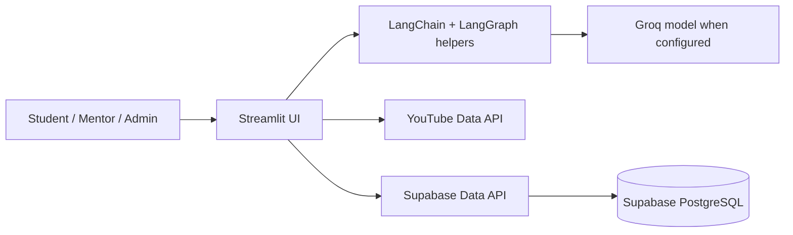
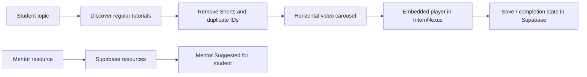
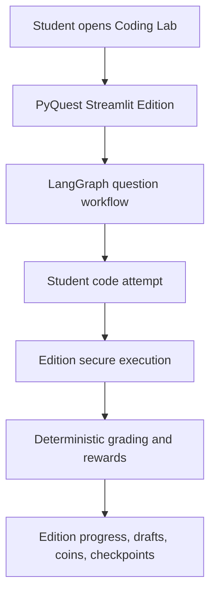
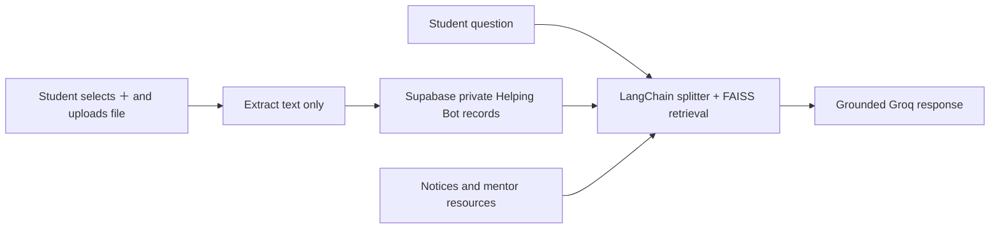

# HCL Intern Nexus

**InternNexus** is an AI-powered internship management and learning platform developed during an HCLTech internship. It provides separate student, mentor, and administrator workspaces in a single Streamlit application.

All shared portal data is stored in **Supabase PostgreSQL** through the Supabase Data API. The app does not use a local SQLite database, so accounts, notices, resources, doubts, meetings, plans, coding attempts, and Helping Bot history survive Streamlit Cloud restarts.

## Core capabilities

- Student, mentor, and administrator account workflows
- Permanent notices, private doubts, mentor learning resources, and account-deletion requests
- Mentor meeting scheduling and recurring Tuesday/Thursday meetings
- In-app YouTube learning: search, playlist loading, filtered regular tutorials, horizontal carousel, embedded `youtube-nocookie` player, saved items and completion state
- Mentor resources are visible in the student's **Mentor Suggested** section
- Python Quest Coding Lab: a launcher for the standalone `pyquest_streamlit_edition/` app, with LangGraph question generation, deterministic grading, checkpoints, secure execution, coins, drafts, and companions
- Helping Bot with per-student permanent chat history, persona preferences, working memory and summary memory; a `＋` document upload control stores extracted text privately in Supabase for LangChain RAG over notices, mentor resources, and the student's own files
- LangChain-oriented deep-agent utilities for HCL content workflows, with safe fallbacks when an AI provider is unavailable
- Responsive brown/beige light and dark visual theme

## Architecture



### Resource learning flow



### PyQuest specialist-agent flow



The standalone edition owns its learner storage and checkpoints. The InternNexus dashboard preserves the HCL authentication session and launches the edition through `PYQUEST_APP_URL`; it does not copy or delete the existing Supabase learner records or historical attempts. The edition's local mode defaults to `http://127.0.0.1:8501/`; hosted InternNexus deployments must configure a public HTTPS PyQuest URL.

### Helping Bot private RAG flow



Uploaded files may be PDF, DOCX, TXT, Markdown, or CSV up to 5 MB. The original binary is not stored in the chat table—only extracted readable text. FAISS vectors are a derived in-process cache; the permanent source of truth is the student's Supabase record. If FastEmbed cannot initialise, the bot falls back to transparent lexical retrieval instead of failing.

## Supabase setup

1. In the Supabase dashboard, open **SQL Editor**.
2. Run [`database/schema.sql`](database/schema.sql).
3. Also run [`database/helping_bot_schema.sql`](database/helping_bot_schema.sql) for permanent Helping Bot profiles and memory snapshots.
4. In Streamlit Cloud, configure secrets using your own rotated values:

```toml
SUPABASE_URL = "https://your-project.supabase.co"
SUPABASE_SECRET_KEY = "your-server-side-secret-key"
YOUTUBE_API_KEY = "your-youtube-data-api-key"
GROQ_API_KEY = "optional"
GROQ_MODEL = "optional-model-name"
WEATHERMAP_API_KEY = "optional"
MENTOR_EMAIL = "mentor@example.com"
TEAMS_MEETING_LINK = "https://teams.microsoft.com/..."
INTERNSHIP_TITLE = "Gen AI Internship"
PYQUEST_DEPLOYMENT = "cloud"
PYQUEST_APP_URL = "https://your-pyquest-app.streamlit.app/"
```

Never commit secrets, database passwords, or API keys. Rotate any value that has been displayed in a chat, image, terminal log, or commit history.

## Run locally

```powershell
git clone https://github.com/ayeshamehreentech/HCL_INTERN_NEXUS.git
cd HCL_INTERN_NEXUS
py -m venv .venv
.\.venv\Scripts\Activate.ps1
python -m pip install -r requirements.txt
streamlit run app.py
```

Add the required variables to `.streamlit/secrets.toml` locally. Do not add that file to Git.

## Streamlit Cloud deployment checklist

1. Push the merged `main` branch to GitHub.
2. Confirm the app points at that repository and branch.
3. Add the secrets listed above in **App settings → Secrets**.
4. Reboot the app after changing secrets or schema.
5. If Supabase reports a missing table or column, re-run both schema files in the SQL Editor.
6. For the student Coding Lab, configure `PYQUEST_DEPLOYMENT = "cloud"` and set `PYQUEST_APP_URL` to the public PyQuest Streamlit URL. Local development may omit it and uses `http://127.0.0.1:8501/`.

## Validation checklist

- Create a student account and confirm it remains available after a reboot.
- Create a notice, resource, doubt, and meeting as mentor; verify the student sees each item.
- Search a video topic and play a result inside the Resources tab.
- Open the configured PyQuest app and verify concept, challenge, grading, draft, checkpoint, and coin flows.
- Send a Helping Bot message, reload the application, and confirm history remains.
- Upload a private study document through the Helping Bot `＋` control; ask a question about it and confirm the retrieved source is shown.

## Security

Keep privileged Supabase keys only in Streamlit secrets. Use the least-privileged key compatible with your Row Level Security policy, and restrict any browser-exposed API keys in their provider dashboard.
