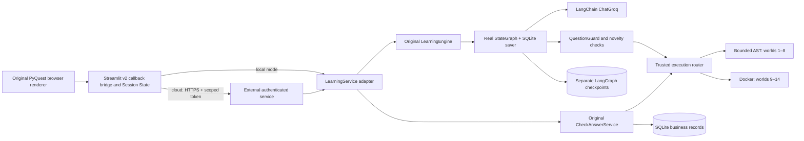

# Architecture

The **copied backend remains independent** of the original checkout. No runtime
imports depend on the original path. Groq keys are environment/secrets values;
the one-time verification launcher read existing configuration into process
memory, not into repository files.

`edition/service.py` is a small backend facade mirroring the existing HTTP
business actions. It delegates generation and evaluation to original classes,
and solution/hint operations to original helpers. Only `edition_drafts` is added
to distinguish an explicitly saved empty draft from a pristine starter editor.
`concept_progress` comes from the existing Concept system.

## Actual graph

`LearningEngine.__init__` builds `StateGraph(LearningState)`:

START → load_learner_state → planner → supervisor → curriculum → performance
→ adaptive → selected world OR remediation → selected world → question_generator
→ question_guard → novelty_guard → persist_quest OR retry OR generation_unavailable
→ END. The supervisor chooses one of fourteen actual specialist classes. The
Planner recommends a plan; adaptive evidence determines the effective difficulty.

QuestionGuard validates schema, world/topic/difficulty, allowed concepts,
private-solution leakage, prior prompt similarity, AST structure novelty, and
reference execution/fixtures. The novelty node consumes guard validity to route
success/retry/unavailable. It is not a separate semantic-equivalence model.

`LearningState` is a `TypedDict(total=False)` with ordinary replacement semantics;
there are no custom Annotated reducers. Learner/session/curriculum runtime
context is carried in state; the reused graph does not define a separate
LangGraph runtime context schema. `PersistentGraph` recompiles with the official
`SqliteSaver` for each operation, closes connections, and serializes same-thread
operations with process-local striped locks. Stable thread key:
`learner_id + ':' + session_id`.

## State boundaries

| State | Owner | Survives frontend restart? |
| --- | --- | --- |
| Widget selections, unsent edits, displayed feedback | Streamlit Session State | No |
| Committed code drafts, profiles, rewards, purchases, mastery | Store / business SQLite | Yes if disk is durable |
| Generation graph state/history | Official SqliteSaver, separate file | Yes if disk is durable |
| Static lessons | `app/concepts.py` | Yes, versioned source |
| Verified user identity | OIDC signed identity cookie / claims | Provider and cookie lifecycle |

Native `persist_state='session'` keeps editor widget values across pages. A
per-question draft buffer prevents accidental starter replacement. The draft API
saves before Run, Check, Review, and Next; successful Review resumes that exact
session. Pending operation IDs are reused after ambiguous network failures.
Backend question/reward uniqueness remains authoritative.

## External durable option

The remote backend stores its two SQLite files on an operator-provisioned cloud
persistent volume. This is an implemented external persistence option, not a
claim of managed PostgreSQL support. A service-restart integration test verifies
both a saved draft and `graph.get_state()` after reconnecting to the same directory.
Production ingress requires TLS. Tokens contain the opaque learner ID, expiry,
and an HMAC signature; the server derives identity from the verified token and
rejects client-supplied identity fields. OIDC identities use a separate HMAC
over `(issuer, subject)`. Anonymous demo IDs are random per browser connection.

The trusted Streamlit server holds the signing secret. End users never see it.
The backend is a **single-process worker** behind a reverse proxy; striped locks
are not distributed locks. Managed relational storage and distributed locks are
future improvements, requiring a deliberate repository/checkpointer migration.

## Rendering

Native Streamlit controls provide responsive cards, accessibility labels,
keyboard focus, code highlighting, tables, and interactive lesson controls. No
learner/model text is inserted as executable HTML. Static companion images use
approved first frames or original outfit source crops. Character animations are
not simulated or regenerated; the original priority code remains in the copied
regression fixtures. No ranking page exists.
